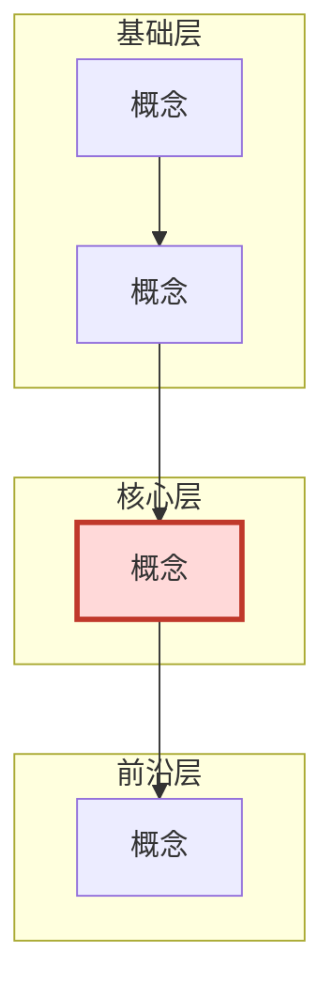

# 产出物模板

十份文件的骨架。**结构照抄，内容按领域与类型替换。**
> 类型（A 算法 / B 系统 / C 实验 / D 形式 / E 应用 / F 人文）决定第 4、5 章怎么写，
> 见 `field-archetypes.md`。下面方括号里给了各类的替换提示。

---

## `README.md`（**入口导航，必须有**）

一页纸。用户在八个文件里会迷路，这张纸就是地图。

```markdown
# <领域> 研究资料包

> 一句话：<这个领域在解决什么>。生成于 <日期>，类型 <B 系统/器件>，核验 <N>/<M> confirmed。

## 如果只读一样
→ [07-研究机会地图.md](07-研究机会地图.md)（我能做什么）
→ 或 [01-系统报告.md](01-系统报告.md) §0 一页速览（这领域在干什么）

## 第一次来，按这个顺序
1. `01` §0 一页速览（10 分钟）
2. `03` 术语中英对照（组会前必看）
3. `04` 阶段一 + 最小可行动作（今天的作业）
4. `07` 方向卡片（想开题时看）

## 每份文件是干什么的
| 文件 | 一句话 | 什么时候看 |
|---|---|---|
| 00-定界与计划 | 边界、关键词、通道、本地资产 | 想扩大/缩小范围时 |
| 01-系统报告 | 全景：脉络/路线/成果/口径/前沿/问题 | 建立整体认识 |
| 02-核心知识-分层讲解 | 每个概念五段式 | 概念卡住时 |
| 03-知识地图 | 依赖图 + 三层 + 术语对照 | 不知道该先学什么 |
| 04-阅读路线 | 三阶段顺序 + 时长 | 开始读论文 |
| 05-自测题库 | 30 题三档 | 检验自己 / 组会前 |
| 06-待核实区 | 未核实/仅书目/不可比/负面结论 | **引用前必查** |
| 07-研究机会地图 | 空白判断 + 方向卡片 + 排序 | 开题、找切入点 |
| 进度 | 做到哪了、下一步 | 隔一段时间回来 |

## 当前进度
- 已完成：<...>
- 未做：<...>
- **下一步动作**：<一个今天就能做的具体动作>
```

---

## `00-定界与计划.md`

```markdown
# <领域> · 定界与计划

## 一句话研究问题
<把"我想学 X"逼成一个可检索的问题>

## 领域类型判定
- **主导类型**：<B 系统/器件>
- **判据**：<这个领域的"好"由"仪器测出来 + 与物理极限对账"定义>
- **辅类型**：<A 算法/模型，用于学习型方法的图像质量指标>
- **影响**：第 4 章按 B 类（含系统参数表），第 5 章写物理极限对账表 + 一张口径谱系表

## 本次范围
- **包含** / **不包含**（写清砍掉什么、为什么砍）
- **时间窗**：<起点> ~ <截止>；"前沿" = 最近 <12> 个月

## 用户画像
阶段 / 已有基础 / 目标 / 时间预算 / 语言偏好

## 关键词矩阵
| 类别 | 词 |
|---|---|
| 英文主词与变体 | |
| 中文主词与译名 | |
| 子方向词 | |
| 上位领域词（找综述） | |
| **负关键词（排除同名不同物）** | |

## 本地资产（**实地核实过，不是推断**）
| 文件/目录 | 能抽出什么 | 可信度 | 已用在哪 |
|---|---|---|---|

## 检索通道预检
| 通道 | 可用? | 备注 |
|---|---|---|
| Crossref / OpenAlex / arXiv API | ✅ | 元数据与摘要最稳 |
| 期刊官网摘要页 | ✅ | |
| 出版商全文页 | ❌ | 403 |
| 中文库 | ❌（需登录） | **派给有校内网的用户** |

## 已知局限
<没查什么、可能漏什么>
```

---

## `01-系统报告.md`

```markdown
# <领域> 全景报告

> 生成日期 ｜ 检索截止 ｜ **领域类型** ｜ 证据规则 ｜ 局限声明

## 0. 一页速览
- **在解决什么问题**：<三句以内>
- **当前最强的 N 条路线**：<路线 — 一句话 — 代表成绩>
- **最值得先读的 5 个**：<按顺序，各一句为什么>
- **一句话结论**

## 1. 发展脉络
### 1.1 前史  ### 1.2 奠基  ### 1.3 范式转换  ### 1.4 当前
> 每个里程碑：之前怎么做 / 改了什么 / 为什么这次能发生。各挂来源。
> ⚠️ 不要写成"算法越来越好"的单线叙事——写**每次换掉的是不同的东西**。

## 2. 核心问题与形式化
<有公式写公式；没有公式的领域写"核心定义与操作化"：这个概念如何被测量/被判定>

## 3. 技术路线 / 流派
| 路线 | 核心思想 | 代表 | 优势 | 代价 | 适用 |
|---|---|---|---|---|---|
### 3.x 路线之间的分歧点
<不要只罗列优点，写清它们在哪儿不同意对方>

## 4. 代表成果
<按类型二选一或组合>
- A：| # | 标题 | 年份 | 会议 | 贡献 | 为什么读 | 代码 | 证据 |
- B：| # | 标题 | 年份 | 期刊 | **系统关键参数** | 贡献 | 证据 |
- C：| # | 标题 | 年份 | 期刊 | **体系/样品** | **测量手段** | 发现 | 证据 |
- D：| # | 标题 | 年份 | 出处 | **定理陈述** | 技术 | 证据 |
- E：| 名称 | 年份 | 发布机构 | **适用范围** | 关键条款 | 证据 |
- F：| 作者 | 年份 | 出版 | **核心论点** | 材料 | 接受度 | 证据 |

## 5. 评价口径
<按类型写：SOTA 表 / 物理极限对账表 / 测量手段分工表 / 猜想状态表 / 合规终点表 / 流派争论表>
### 5.x 口径之间能不能比？
<这一段极重要。明确写出哪些数字**不可横向比较**，为什么。>

## 6. 前沿趋势（近 12 个月）
### 6.1 已形成共识  ### 6.2 仍在争  ### 6.3 被证伪或退潮  ### 6.4 边界被推走（非证伪）

## 7. 尚未解决的问题
### 问题 1：<...>
- **为什么难**：<关键：说清难在哪，不是"还没人做">
- **卡在**：理论 / 数据 / 算力 / 评测 / 伦理 / 成本
- **可能的切入点**：<一句话，详见 07>

## 8. 给<用户阶段>的建议
- 必须先学 / 可以跳过（附理由） / 建议的第一个小目标
```

---

## `02-核心知识-分层讲解.md`

三层（基础 / 核心 / 前沿），每概念五段式：

```markdown
### 概念名（English Term / ABBR）
1. **一句话直觉** — 类比，不出现符号
2. **形式化 / 操作化定义** — 有公式写公式，每个符号解释一次；
   没有公式的领域写"如何操作化测量它、单位是什么、典型量级是多少"
3. **最小例子** — 能手算 / 最小实验 / 最小反例 / 一个真实案例，给具体数值或条件
4. **前置知识** — 指向本文件其他概念或基础
5. **常见误解** — 1-2 处，写清**错的人具体会怎么错、错在推导的哪一步**
```

> "常见误解"不许写"注意区分 A 和 B"这类废话。

---

## `03-知识地图.md`

````markdown
# <领域> 知识地图


> 边 = "必须先懂"，**不能有环**。出现环说明概念切分有问题，回去拆。
> 节点超过 40 个时，把"前沿层"合并成一个大节点，细节写进下面的表。

## 三层清单
| 层 | 概念 | 为什么在这一层 | 你的状态 |
|---|---|---|---|

## 术语对照表
| 中文译名 | 英文原词 | 缩写 | 一句话定义 |
|---|---|---|---|
<!-- citations: index-only -->
````

> 术语表是**速查表**，出处已在正文核验，不重复挂标记。
> 表上方那行注释让 `verify_citations.py` 跳过本文件。

---

## `04-阅读路线.md`

```markdown
## 阶段一 · 入门（建立直觉）
| # | 读什么 | 类型 | 前置 | 难度 | 时长 | 读完能回答 |
|---|---|---|---|---|---|---|

## 阶段二 · 核心（主战场）
## 阶段三 · 前沿（近 12 个月）

## 最小可行动作
**今天**：读 <哪个> 的 <哪几节>，带着这个问题读：<...>
**读完的判断标准**：你能不能向别人解释 <...>？

## 可以跳过（附理由）
| 可以跳过 | 理由 |
|---|---|
```

---

## `05-自测题库.md`

```markdown
## A 档 · 概念理解（10-12 题）
**A1.** <题目>
- **答案**：
- **考点**：

## B 档 · 推导与计算（8-10 题）
## C 档 · 设计与权衡（7-8 题）
**C1.** <给定场景，问该选哪条路线，为什么，代价是什么>
- **好答案长什么样**：<列出得分点：是否识别了约束、是否比较了至少两条路线、
  是否说出代价、是否给出失效条件>
- **考点**：
```

> C 档题目应当**直接来自 `07-研究机会地图.md`** 的方向卡片——这样自测就变成"练开题"。

---

## `06-待核实区.md`

```markdown
## 1. 只有书目，摘要/正文未取到
| # | 条目 | 卡在哪 | 缺什么 | 建议怎么补 |

## 2. 仅题录/标题级（**不建议写入正文**）
## 3. 有来源但数字/口径存疑（引用时须限定）
## 4. 冲突条目（并列，不裁决）
## 5. **不可比条目（`incomparable`）**
| # | 条目 | 各来源 | 为什么不可比 | 引用时必须加什么限定 |
|---|---|---|---|---|

## 6. 负面检索结论（"没找到" ≠ "不存在"）
```

---

## `07-研究机会地图.md`（**本技能的核心产出**）

```markdown
# <领域> 研究机会地图

> 生成日期 ｜ 依据：01-系统报告 §6/§7 + _scan/ 方法族笔记 + **实地核实的本地资产**
> 空白判断规则见 `field-mastery/references/evidence-rules.md`

## 0. 一句话结论
<先给判断。用户要的是判断，不是清单。>

## 1. 拆维：把复合词拆开
用户问「<多模态> 是空白吗」——但这个词至少含 <N> 个维度，各维空白程度不同：

| 维度 | 具体内容 | 空白程度 | 依据 |
|---|---|---|---|
| L1 <多视角> | <...> | **完全不空白，它是本体** | <来源> |
| L2 <跨传感器> | <...> | **真空白**（相邻领域已跑通） | <来源> |
| L3 <多物理量> | <...> | 半空白 / 检索零命中 | <来源> |

## 2. 先排掉三种"假空白"
| 假空白 | 本领域的具体情况 | 怎么判断 |
|---|---|---|
| 检索不到 ≠ 不存在 | <中文刊/会议/专利没覆盖> | <换通道验证> |
| 物理/逻辑不成立 | <某个"没人做"其实是算过发现收益为负> | <算数量级> |
| 没人公开 ≠ 没人做 | <数据集空白但有人有> | <看致谢/专利/学位论文> |

## 3. 方向卡片

### D1｜<方向名>  ★★★
- **空白类型**：真空白
- **属于维度**：L3 多物理量
- **要做什么**：<一句话 + 3 步以内>
- **为什么现在能做**：<时机论证：新硬件？新数据？别的方法能迁移？别人没做是因为什么？>
- **第一步判据（最小验证）**：<≤2 天或 ≤1 周，能证伪；写清"看到什么就停">
- **需要的资产**：
  - 已有（**实地核实**）：<路径 + 具体内容>
  - 缺：<...>，从哪拿：<...>
- **代价与风险**：<算力/数据/硬件/**审稿风险**>
- **可行性**：★★★ 半年内能出结果
- **最容易被问倒的**：<一句话> → <怎么回答>

### D2｜<方向名>  ★★
（同上字段）

## 4. 排序与建议组合

| 方向 | 空白类型 | 可行性 | 依赖资产 | 一句话 |
|---|---|---|---|---|
| D1 | 真空白 | ★★★ | <...> | |
| D2 | 假空白（你们正在做） | ★★★ | <...> | |

**建议组合**
- **主线**：<D?> — 理由：<边际成本最低 / 最像论文 / 数据已就绪>
- **副线**：<D?> — 理由：<风险最低，可作 evaluation 亮点>
- **长期押注**：<D?> — 理由：<最像真创新，但需先解决 X>
- **暂缓**：<D?> — 理由：<...>
- **不建议先做**：<D?> — 理由：<容易被当成工程活>

## 5. 三句防守（写论文/汇报时用）
1. <关于术语区分的一句话>
2. <关于方法差异的一句话>
3. <关于实验设计的一句话>
```

---

## `进度.md`

```markdown
# 进度与待办

- **已完成**：Phase 0-5，产出 <N> 份文件；核验 <confirmed>/<total>
- **本次覆盖** / **未做**
- **本地一手证据**：<文件 → 抽出了什么>
- **已读**：（用户自己更新）
- **下一步（按优先级）**：
  1. <今天，2 小时> 读 <哪一篇哪几节>，只带一个问题：<...>
  2. <本周，半天> 做 <一个能算出的数 / 能跑的实验>
  3. <两周内> 补齐待核实区 + 国内文献
- **未解决问题**：<N> 条，见 `01` §7 与 Mnemon 记忆空间
```
